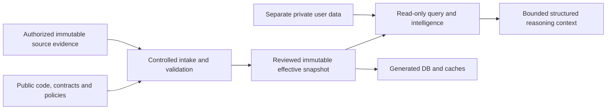

# External canonical card-data plane — accepted architecture direction

**Status: Decision 017 Accepted by owner. No runtime support implemented.**

**Classification: Architecture v13 — ACTIVE APPROVED architecture.** Architecture
v12 is the previous historical baseline. The owner approved the direction reviewed
at `3d21656b9f67a3089f32c5613804a1984fb44139` in PR #175. This acceptance is a
documentation/governance transition only; no runtime implementation is authorized,
no data permissions are granted and no dataset is admitted.

Audit baseline: `ec8fcbf97c84d24337503c81dd1c31a31e163d44`, the merge of PR #174.
The architecture branch starts exactly there. Existing production has 384 Cards,
913 Printings and 235 identifiers; the MB2 810 expansion remains pending.

## Accepted direction and retained options ranking

Adopt **Option 8: public architectural authority with operator-managed immutable
effective canonical snapshots**, delivered initially as the single-bundle form
of Option 3. An optional permitted public core and separately permitted rich
modules may be assembled into one reviewed, validated effective snapshot before
activation. There are no independent live canonical overlays or implicit merges.
Private Git is a possible authoring/audit backend, not a required runtime service.
User-supplied data is an intake mode, not automatically canonical authority.

Rank: **8, 3, 2, 7, 6, 1, 4, 5**. Option 3 is the second-best complete model
and the smallest implementation target. [The options review](EXTERNAL_CARD_DATA_PLANE_OPTIONS.md)
evaluates all requested dimensions, including when an alternative is useful.

The recommendation preserves reproducibility, structured knowledge, source
lineage, generic game boundaries and open contribution while allowing richer
datasets that cannot be publicly redistributed. It moves authority to an exact
reviewed artifact, not to a provider's current API or an editable production DB.
It does not solve missing processing or retention permission.

## Five authorities

| Authority | Owns | Does not own |
| --- | --- | --- |
| Public code/architecture repository | Reviewed schemas, identity/validation rules, algorithms, transformations, adapters, migrations, contracts, safe fixtures and publishable policy specifications | Every production Card value or an unrestricted right to redistribute sources |
| Canonical production snapshot | The exact approved structured entities, relationships, permitted assertions and capability/completeness states consumed by one operation | All real-world truth, future provider revisions, prices by default, or ownership of a physical copy |
| Source evidence plane | Immutable retained source bytes or explicitly scoped exact projections, receipts, notices and transformation/acquisition history | Canonical status merely because an acquisition succeeded |
| Generated persistence | Rebuildable indexes, SQL tables, projections and caches derived from a pinned snapshot and materializer | Independent writable knowledge authority or new facts |
| Personal/user plane | Private collection imports, holdings, storage, preferences and assessments, each with its own version/history | The shared catalog, card-source credentials, or a universal assessment of Card quality |

They need not be co-located. A deployment may keep canonical and source evidence
in one protected artifact store with separate access scopes; personal data remains
a distinct trust domain. The storage backend is not the authority definition.

"Canonical" means **reviewed structured authority for a specified game, scope
and snapshot**, eligible for consumption only after applicable validation and
permission gates. Schema validity, a digest, a provider response, a commit, a
database row, a conversation or an LLM answer cannot grant that status.

## Current conflicts and what stays unchanged

Historical Decision 004 says Git owns canonical datasets and generated databases
can be rebuilt from that repository. The v12 DATA_MODEL and DATA_REPOSITORY stated
this Tier-0 authority invariant. A production bundle that public Git cannot reconstruct
changes that invariant. Calling it a different data-root path would hide the
change. Accepted Decision 017 therefore prospectively supersedes only those public-Git production-data
authority and rebuild-from-public-Git clauses; public architectural authority
and generated-database subordination remain.

Decision 009's Raw → Processed → Canonical → Validated lifecycle remains. Its
repository-approved canonical wording is explicitly refined to approval under
repository-owned contracts in a selected operator snapshot. Decision 010's
SQLAlchemy-generated persistence direction remains; its inputs become code plus
authorized snapshot, not public Git alone. Decision 011's structured knowledge
invariant remains, with repository-data wording clarified for selected snapshots.
Accepted historical decision text is unchanged; Decision 017 is Accepted.

Unchanged invariants: stable IDs, game-neutral shared engines, data-driven
products, explicit reviewed admission, validation before consumption, immutable
evidence, deterministic outputs, unknown/conflict handling, layered consumers and
AI grounded in structured knowledge. New storage grants no market, rules,
simulation, automatic-reassessment or AI-transport implementation authorization.

## Audit findings

The current system already supports injected filesystem roots in several readers
and already has some Git-ignored raw/reference acquisitions. It is inaccurate to
say every source response is publicly committed. Bounded permanent evidence and
production canonical state, however, are repository/Git-backed today.

The query view merges the typed tree, promoted `canonical/state.json`, knowledge
state and admission lineage. A snapshot cannot inventory just the typed tree.
Its representation profile must bind those generations and the actual precedence
rules. A complete logical attachment has one graph; incompatible duplicate claims
cannot be accepted by silently changing path order.

Current names and identifiers need not be removed or rekeyed if a future operator
snapshot has the required permissions. The current Card schema/writer/collection
resolver still require names. Required data missing or prohibited by permission
means no valid compatible snapshot, not a fabricated placeholder or nameless Card.

SQLAlchemy models/materialization and a production REST API are not implemented.
The SQLite file used by MTGJSON streaming is a transient work index, not canonical
SQL persistence. `docs/API_CONTRACT.md` is absent; implemented query/semantic,
import and reasoning contracts were audited instead. Historical "current" phase
headings in README/inventory/status are not evidence that planned systems exist.

[The compatibility map](EXTERNAL_CARD_DATA_PLANE_COMPATIBILITY.md) records current
dependencies, exact source entry points, migration difficulty and known blockers.

## Minimal data-plane interface — proposed, not implemented

The first implementation should reuse current repository readers through one
verified read-only attachment. It is not another importer, canonical store,
provider framework or authentication service.

| Operation | Proposed boundary and result |
| --- | --- |
| Discover | Enumerate only configured local/store candidates and declared identities; inspection grants no authority and fetches no provider data |
| Stage transfer | Explicit operator action uses scoped transport credentials to a bounded staging area; no consumer-triggered network fetch |
| Verify | Exact file inventory, hashes, safe paths, schemas, relationships, source/provenance closure and report inputs must match |
| Authorize use | Trusted deployment/review boundary checks actual authenticated decisions and operation-specific permissions; request-authored actor/approved fields are insufficient |
| Attach | Return immutable handle binding game, snapshot ID, schema/policy versions, capabilities and bounded canonical/evidence accessors |
| Query | Construct existing readers from that handle's complete roots; no mixing ambient checkout data, current provider results or another game |
| Materialize | Generate DB/index/projection under an isolated output root keyed to handle and materializer; validation does not imply currently unsupported typed materialization |
| Activate | Compare expected active snapshot, validate consumers, then atomically select a new handle; in-flight operations retain their previous handle |
| Roll back | Explicitly select an intact, still-permitted compatible previous snapshot; do not undo personal audits or rewrite records |
| Reasoning access | Produce permitted structured projection and omissions bound to exact catalog/evidence/user/policy inputs; hosted model transport is a separate permission boundary |

Production without an explicit compatible validated attachment returns a structured
blocked result. Optional source coverage may return incomplete/ABSTAIN within an
otherwise valid snapshot. Corruption, invalid identity and missing optional
coverage remain different errors. No implicit public seed, last-cache or historical
snapshot fallback may conceal missing current authority. A developer may explicitly
select a fictional fixture profile; it is never eligible for production admission.

Existing `AutomaticCanonicalUpdate` is deliberately repository-relative and
Git-publication scoped. A future build/release destination must migrate its scope
and trusted host integration through an approved adapter, retaining exact ordered
candidates, bytes, policy, pre-state, immediate revalidation, dependencies, actual
consumer acceptance and failure recovery. Do not disable path checks or use
`IsolatedAdmissionTestBoundary` for production. Public code PRs and protected data
releases remain separate; no private data PR to this public repository is proposed.

## Identity, snapshots and deterministic results

Existing Card/Printing/candidate/alias identities remain unchanged. Storage location
does not participate in the mapper's natural identity. Magic's admitted Oracle
UUIDs and MTGJSON Printing UUIDs remain canonical keys where already used; typed
legacy IDs also remain valid. Candidate hashes are not canonical IDs. Provider
replacement adds reviewed, versioned equivalence mappings rather than renaming
entities, matching on names, or assigning arbitrary physical Printings.

Use `(game, entity_type, existing_id)` for routing and mapping scope, not a new
ID encoding. Current unscoped single-game production records need an explicit
legacy game profile before multi-game attachment; they cannot be inherited by
another game. Collection references bind catalog snapshot plus identity. Name
fallback remains weaker than exact physical Printing evidence. Old audits keep
their original catalog binding; a new catalog produces a newly identified audit.

[The snapshot contract](EXTERNAL_CARD_DATA_PLANE_SNAPSHOT.md) separates content,
validation and release identities without a digest cycle. The new authority ID is
not the existing entity-envelope query snapshot ID. Preserve both and retain
legacy query hashes and historical fixtures exactly. A hash cannot reconstruct
unavailable source bytes or prove replay remains possible.

An analytical result must bind code revision, canonical snapshot ID, query identity,
schema/policy/algorithm versions, configuration, source/evidence manifest IDs,
selected market/format/user inputs and seed/PRNG version when applicable. Provider
observed/retrieved times and explicit `as_of` are inputs; ambient clock/timezone,
network order and filesystem enumeration are not domain calculation inputs.

## Capability consequences

| Capability | Required pinned structured inputs and failure behavior |
| --- | --- |
| Gameplay Rules Intelligence | Reviewed rules-engine version plus structured mechanics/rules sources and exact format/date; no rules execution implemented by this proposal |
| Oracle/comprehensive rules knowledge | Separate versioned, permissioned text/evidence and interpretation modules; Card count does not establish rules coverage |
| Timing, legality and interactions | Exact rules/legality revision, game state and deterministic interpreter; incomplete required semantics blocks, not an LLM/name heuristic |
| Deck Intelligence | Catalog, format/legality, deck definition/objective and available evidence; existing deck-completion helpers are not the planned strategic domain |
| Competitive Intelligence | Tournament/usage/context/time evidence and policy independent of catalog; remains parked without evidence/authorization |
| Collection Intelligence | Private import/holdings revision plus selected catalog; preserve ambiguity, language/finish uncertainty, ownership dates and immutable prior audits |
| Product Intelligence | Exact product/component graph, guaranteed contents or evidenced slots/sheets, independent offers/value inputs and human-ready packet |
| Market Intelligence | Independently versioned append-only observations, mappings, dimensions and `as_of`; no prices invented by a richer card snapshot |
| Pack/product simulation | Validated slot/sheet/weight/replacement/collation evidence; catalog expansion alone does not establish a pack model |
| Monte Carlo | Same snapshot/configuration, algorithm and PRNG/version/seed; no stochastic engine introduced here |
| AI reasoning/explanations | Structured validated authorized contexts with citations, omissions and deterministic results; no conversation memory as canonical facts, no LLM approval or outcome override |

The current reasoning context builder copies values/provenance and enforces size
limits; that is not yet an export-permission boundary. Private dataset access does
not authorize sending it to an external model, logs or public output. Local model
use also requires the applicable processing permission. Retrieval/embedding caches
are derived sensitive data and bind snapshot/model/index versions. Provider prose
is untrusted data, never operational instructions. Future explanations may vary by
model, but cannot change deterministic calculations; retain exact input/output
bindings and model/version/settings where explanations are retained permissibly.

## Permission, security, CI and migration

Permissions to process, privately retain canonical data, privately retain source
evidence, publicly redistribute, operate a free/commercial service and export to
an AI destination are separate gates. A compatible manifest, encryption, private
Git, object storage or operator possession supplies none of them.

[The security model](EXTERNAL_CARD_DATA_PLANE_SECURITY.md) separates catalog,
evidence, personal data, credentials, derived stores, logs, artifacts and backups.
[The migration plan](EXTERNAL_CARD_DATA_PLANE_MIGRATION.md) provides acceptance,
tests and rollback for every stage and separate public/private CI tiers.

Public contributors run original-author fictional datasets and safe explicitly
selected historical fixtures, without private credentials/data. Private integration
uses trusted reviewed code and protected snapshots; it never mounts secrets into
fork/unreviewed PR code or uploads private contents as public artifacts.

No historical public evidence is rewritten/deleted, and no dataset is newly
declared redistributable because it was already in Git. Where future retention
permission expires, access must be revoked and replay availability reported
honestly; physical retention decisions require their own authorized policy action.

MB2 is the reference acceptance case, not engine logic. The 810 selected IDs,
nine holds, Japanese Printing distinction, owner spelling uncertainty and emblem
semantics remain unchanged. Private processing and retention remain unresolved
alongside public/service use. Externalizing them is not an admission or clearance.

## Acceptance and remaining authorization boundaries

The owner accepted Decision 017 and the v13 direction. This transition records
governance only. Existing runtime remains filesystem/Git-bound; no external loader,
runtime schema registry, snapshot activation service, SQL, writer destination,
workflow, production data, MB2 configuration or source-policy clearance changes.
Documentation tests reflect acceptance; the historical replay auxiliary fixture
continues to bind original Architecture-v12 bytes independently of current docs.

The next documented milestone is **V13 Stage 1 — Fictional Canonical Snapshot
Attachment**, NOT AUTHORIZED. Its [future scope and exclusions](EXTERNAL_CARD_DATA_PLANE_MIGRATION.md#v13-stage-1--fictional-canonical-snapshot-attachment)
require separate owner implementation approval. Architecture acceptance grants no
processing, private-retention, public-redistribution, free/commercial application
or AI-export permission; no protected snapshot, MB2 admission, source-policy plan,
network acquisition, SQL, Rules Intelligence or simulation work. It resolves no
nine held multiface candidates, spelling proposals or physical Printing identities.
`SOURCE_POLICY_CLEARED_PLANS` remains unchanged. Stop for independent merge review;
this documentation approval does not authorize merging PR #175.
