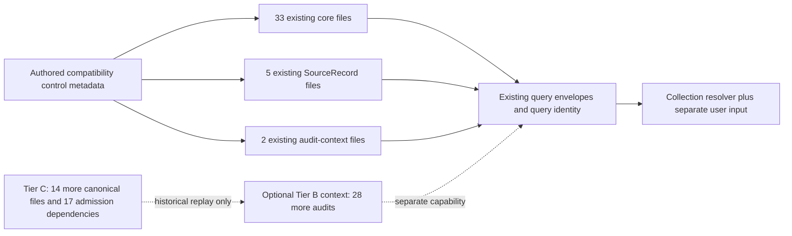

# Legacy/Public Profile Permission and Closure Contract

Status: separately owner-authorized research/design/governance complete, pending
independent PM review. Reviewed canonical main:
`d4e673a31714e30eb4056c43fca76b159008c813` (PR #177 merged).
Architecture v13 and Accepted Decision 017 are unchanged. This is not runtime
implementation, source-policy clearance, data admission or activation authority.

## Decision and its limits

**READY_FOR_NON_PRODUCTION_STAGE3** for exactly **Tier A —
CATALOG_QUERY_COLLECTION**, using project-authored code/control metadata and
explicit references to existing tracked bytes **in place**. Recommended next
candidate: **V13 Stage 3 — Legacy/Public Compatibility Snapshot Profile**,
**NOT AUTHORIZED**. This changes the proposed implementation target from a
production release to a strictly non-production compatibility contract; it does
not overturn Stage 2's historical **production** readiness blocker.

The complete mixed-content rights chain remains **NOT_ESTABLISHED**, including
private processing, private retention and existing-public-Git use. The engineering
recommendation does not declare those operations permitted. Neither non-production
labeling nor in-place storage grants a license. No operator production snapshot,
service, new corpus, data export or novel analytical operation is cleared.

Stage 3 can implement and test a generic compatibility boundary with fictional
data, and describe the already-existing legacy inputs with metadata. Existing
public-root parity is a separately identified compatibility characterization,
with the unresolved data-permission status visible; it must not be described as
a permission-certified execution. If the implementation requires a new data copy,
derivative, export or permission-complete operation, that extension stops for
separate review. It cannot hide behind this engineering-readiness decision.

**OPERATOR_PRODUCTION_SNAPSHOT remains BLOCKED.** It requires the exact permitted
processing/retention/use scopes, closed evidence dependencies and later explicit
owner admission/activation. Decision 017 approval and this contract grant none.

## Capability tiers and dependency graph

The [retained package](../reference-reviews/v13-legacy-profile-permission-closure/)
contains eleven JSON metadata files, not a snapshot or provider corpus. Exact
paths, lengths, hashes, placements and the original Stage 2 references are in
`dependency-closure.json`. All old Stage 2 artifacts stay unchanged.

| Tier | Target | Bound files | Included behavior |
| --- | --- | ---: | --- |
| **A, selected** | CATALOG_QUERY_COLLECTION | **40** | Entity/search/relationship/snapshot outputs and entity provenance; Collection identity resolution; entity-local semantic catalog queries |
| B, not selected | FULL_QUERY_AUDIT | **68 = 40 + 28** | Complete current audit, rejected, validation-failure and promotion-history APIs |
| C, not selected | HISTORICAL_ADMISSION_REPLAY | **99 = 82 + 17** | All 52 canonical bytes plus 30 audits for old pre-state/full-query parity, plus 17 original admission dependencies |

Tier A is **33 core files + five SourceRecord references + two audit-context
files**, not forty interchangeable canonical entities. The core is fifteen typed
Cards, fifteen typed Printings, Game, foundation Product and the original promoted
state. SourceRecords remain evidence metadata; they are not Card entities. The
broader canonical census has eight SourceRecords, but only five are required here.



The two audit files are the original Phase 119 and Phase 136 bounded promotions.
Their complete bytes/hash and relative paths are needed for exact entity
provenance; they are separately bound **AUDIT_CONTEXT**, never live approval.
SourceRecord references do not imply underlying provider archives were verified,
permitted or bundled. Original source revalidation is outside Tier A. Even Tier C's
99 known read dependencies do not certify universal original-provider replay.

Core, control metadata, source references, audit context and historical replay
context keep distinct placements. Market observations/history, knowledge facts,
mechanical dossiers, Product/Decision Intelligence, reasoning contexts, personal
collections, pending MB2 records, AI/model data, source corpora, credentials,
caches, logs and backups are **EXCLUDED_DOMAIN**. No giant `data/` bundle.

## Root, identity and API parity contract

The authoritative **new compatibility target** is explicit BOTH-root construction:

```python
CanonicalQueryEngine("magic", data_root=explicit_repository / "data",
                     games_root=explicit_repository / "data/canonical/games")
```

At this reviewed baseline the query has **399 Cards, 928 Printings, 235
Identifiers, two Finishes, one Game and one Product: 1,566 entities**. Promoted
state contributes 384/913/235/2 = 1,534 records; typed contributes 15/15/1/1.
Exact typed/promoted Card ID and Printing ID overlaps are both zero. No identity
merge or name-based substitution is recommended.

Existing query identity remains:
`sha256:7cee417d40186169829d812c1edd4db6d6934f75f3eeb7183dae09f61bb437a7`.
Keep typed-first precedence for identical `(entity_type, ID)`, original values,
language labels, aliases, uncertainty, provenance and relationships. Do not
flatten state into typed v3, manufacture field assertions or change query hashing.

The bare constructor's **32-entity** result and
`sha256:e580c987f4e7cae0c0a69e22dc025e468ceacef078a4ff907935c1d54998fa6e`
are **legacy convenience/path-inference technical debt**, not equivalent parity.
The new explicit profile supersedes that accidental scope **as the Stage 3 target
only**. Existing bare-constructor behavior stays unchanged; no default-root fix,
implicit migration or fallback is authorized.

The whole-canonical pre-state
`881c4ddf1dd5f3dc8004aef001277407e359b165cba6d9f5e8d442e9eef48077`
is an unchanged historical reference. Forty selected files cannot certify it:
it includes all 52 canonical files. Outer profile/control/content identities,
the existing query identity and that whole-canonical digest remain distinct.

**Required future read-side change:** current query construction physically scans
all thirty audits, despite the forty-file entity-output closure. Stage 3 must
introduce a small explicit audit-inventory/capability seam through the existing
readers, preserving unrestricted legacy behavior only when explicitly selected.
Tier A may read only its two declared audits, with unchanged `audit/...` relative
paths. Merely omitting 28 audits from a manifest while still scanning them fails
this contract. SourceRecord validation must likewise stay within the declared
five references; entity/source glob expansion must be detected before reading
new unbound inputs. Bind the single-game directory namespace too: Collection
resolution must not inherit unscoped promoted rows into another game. Cover all
current reader globs, including product_versions, packs, slots, sheets/print_sheets,
finishes, treatments and rarities even when empty. Public schema/code bindings
are separate public contract dependencies, not additional canonical content.
No copied query engine or hidden temporary catalog view.

Tier A must reject `related(..., "promotion_audits")`, `validation("rejected")`,
`validation("validation_failure")`, aggregate `validation/validation_statistics`
and corresponding semantic `list_validation` audit modes **before I/O**, returning
an explicit unsupported capability rather than misleading empty data. Entity-local
unknown/conflicting/unresolved/superseded states and selected entity provenance
remain available. Tier B/C are separate future contexts, not implicit fallback.

`canonical/knowledge/state.json` is absent at baseline. Pin that absence and the
selected typed/source inventory. New optional state or a new entity in a scanned
namespace must invalidate the selected profile, not silently expand it. Unrelated
out-of-scope files may remain in place but must not be read, copied or promoted.

## Field and component rights chain

`field-inventory.json` inventories **354 storage field paths** and
`query-field-inventory.json` inventories **335 query-envelope paths**. All **689**
have an explicit permission-profile disposition in `permission-matrix.json`.
Array positions/entity IDs and source-valued dynamic audit keys are normalized;
the package retains field names/types/counts, not their source values.

| Layer | Exact affected categories | Evidence disposition |
| --- | --- | --- |
| Project-authored technical controls | Schema/status/confidence fields, hashes and control envelopes | Provider-content permission NOT_APPLICABLE to those pure controls; this never clears mixed enclosing files |
| Typed identity and assertions | Card/Printing/Game/Product identities, names, facts, source titles, relationship/member assertions | Wizards/Gatherer, Scryfall and project-derived structure; complete operation permission NOT_ESTABLISHED |
| Promoted identity/linkage | MTGJSON UUIDs, Card references, Scryfall aliases, set/collector/language/finish/layout and relationships | Immediate MTGJSON provenance; independent upstream rights remain unresolved |
| Descriptive/mechanical fields | Names/normalized names, colors, mana/type labels, printing facts, original and foreign fields | No assumption that short/factual/derived fields share the same rights status |
| Embedded unknown fields | Rules/printed/flavor text, rulings, foreign prose, artist/artwork data, EDHREC metrics, purchase URLs and SKUs | Physically present in selected state bytes even when omitted from query output; all covered by the unresolved mixed-content review |
| Source and audit context | Source metadata/claims, source URLs, acquisition/admission lineage, historical IDs and names | Separate context is not permission, admission or authority; full bytes may contain upstream values |

Identifier namespaces include Card Kingdom, Cardsphere, Deckbox, Cardmarket,
MTGO/Wizards, Scryfall, TCGplayer and MTGJSON contributions. EDHREC and artwork
metadata also survive in unknown fields. MTGJSON's provider label cannot grant
another issuer's rights. The exact namespace counts and every nested field
disposition are retained without retrieving these providers' datasets.

### Seven operation-specific evidence states

For the **complete mixed required closure**, all seven are **NOT_ESTABLISHED**:

| Operation | Missing or ambiguous evidence |
| --- | --- |
| LOCAL_PRIVATE_PROCESSING | Complete upstream permission/applicability for exact mixed fields and transformations |
| PRIVATE_OPERATOR_RETENTION | Permission/retention scope across all relevant issuers; private location is insufficient |
| EXISTING_PUBLIC_GIT_COMPATIBILITY | No new underlying permission established by public history, hashing or non-production labeling; authored metadata scope is a separate engineering question |
| NEW_PUBLIC_REPOSITORY_REDISTRIBUTION | Exact field/context/notice distribution chain; referencing bytes differs from copying/reformatting/bundling them |
| FREE_PUBLIC_APPLICATION_SERVICE | Concrete features/exposed data and applicability of any qualifying-use grant |
| COMMERCIAL_OR_PAID_SERVICE | Applicable commercial rights across every relevant layer; free fan creation/ads/donations are not a paid database grant |
| AI_OR_MODEL_EXPORT | Exact recipient/model/transport, fields, retention/training and downstream rights; no implicit export to any model |

The matrix separately records **ESTABLISHED_WITH_CONDITIONS** for MTGJSON-controlled
material alone under its MIT grant. That supplementary profile is applied to
**no required mixed field**. Pure project control fields marked NOT_APPLICABLE
make no provider grant and cannot clear the mixed file. These explicit distinctions
prevent permission inheritance through a provider name or an enclosing metadata key.

## Bounded first-party evidence and notices

`source-evidence-index.json` retains issuer/title/URL, retrieval time, capture form,
hash, applicability, bounded summary/quotation, conditions and missing evidence.
Eight official pages were checked on 2026-10-15. Five were available:

- [MTGJSON License](https://mtgjson.com/license/) and [FAQ](https://mtgjson.com/faq/):
  MIT permits covered-material use/copy/distribution/commercial reuse with the
  copyright and permission notice. No complete upstream sublicense is established.
- [Scryfall access FAQ](https://scryfall.com/docs/faqs/i-m-having-trouble-accessing-the-scryfall-api-or-i-m-blocked-17):
  bulk local-processing guidance and Wizards attribution, not complete API/data
  redistribution, retention or service permission for this mixed source chain.
- [Wizards General Terms](https://company.wizards.com/en/legal/terms) and
  [Fan Content Policy](https://company.wizards.com/en/legal/fancontentpolicy):
  website/service terms and conditional original free fan creation. No blanket
  verbatim database redistribution, paid-service or AI-export grant is established.

Scryfall's `/docs/api`, `/docs/api/bulk-data` and `/docs/terms` each returned
**403** through the supported reader: **NOT_ESTABLISHED — EVIDENCE UNAVAILABLE**
for any substantive provisions there. This establishes neither permission nor
prohibition. No provider contact, account change or open-ended upstream research.

New hashes bind exact **web-reader response envelopes, not origin HTTP entity
bytes**. Full response captures remain private and are not execution dependencies.
The public bounded summaries/quotes have their own manifest integrity. Five prior
public policy payloads/receipts are independently hash/length-verified and referenced
without redownloading, relabeling or changing them. A capture hash authenticates
neither issuer nor reviewer; first-party origin and capture method remain explicit.

`notice-requirements.json` defines placement and triggers:

- Preserve the complete existing MTGJSON copyright/MIT permission notice whenever
  covered material is copied; use its retained full-notice reference, not an
  abbreviated replacement. Future permitted manifests/deployments bind that notice.
- Preserve existing source-specific notices/provenance. No general Scryfall
  redistribution-attribution obligation or waiver was recovered; leave it unresolved.
- Only if a future use separately qualifies under Wizards' fan policy, place its
  required unofficial/nonendorsement/property notice in the applicable UI/API and
  deployment context. Do not install a notice claiming current qualification.
- Source evidence retains issuer, URL, time, capture type, hashes and limits.
  Notice compliance never substitutes for operation-specific permission.

## Actual Stage 3 actions and CI placement

| Proposed action | New provider values retained/distributed? | Boundary |
| --- | --- | --- |
| Author generic code, metadata, field names/counts and fictional tests | No | Engineering only; not implementation authorization here |
| Record existing paths/hashes/absence and explicit capability/root selection | No copied values or new bundle | Referents keep unresolved permissions; hash does not clear them |
| Characterize existing public legacy queries with separate fictional collection input | No new persisted/exported corpus | Existing compatibility observation, not source permission; no physical ownership inference |
| Copy/reformat values, create downloadable catalog bundle, serve data, AI export or activate operator authority | Yes/new use | Excluded; requires its own evidence and authorization |

Public CI uses authored metadata, bounded policy evidence and fictional mixed
fixtures for all new capability/security/relocation behavior. It needs no private
catalog or credentials. Existing public historical replay remains explicitly scoped
to its original inputs/identities; no new real corpus is introduced and its history
does not certify rights. If a later policy review restricts old bytes, preserve
their identities and permitted protected replay placement, with fictional public
contract equivalents; do not silently skip checks or repin expected results.

Protected CI is a later **unavailable, unauthorized** tier: reviewed trusted code,
exact permissioned snapshot/evidence mounts, separately scoped personal inputs,
private logs/caches/backups and reviewed contentless reports. No fork code receives
protected data or credentials. No protected values, user files, full captures,
tokens or unreviewed logs may enter public artifacts. Passing either CI tier
establishes no permission or owner admission decision.

## Declared legacy incompleteness

- Thirty historical Printings reference missing Finish labels: signed **21**,
  etched **9**. Declare **incomplete**, retain labels and existing resolution;
  do not invent Finishes or impose the fictional profile's stricter graph.
- Typed materialization is **incomplete**. Original flat admissions retain their
  actual evidence/contracts; validating them does not manufacture v3 field lineage.
- Optional knowledge state is **unavailable/absent**. Knowledge facts elsewhere
  are an excluded plane, not a substitute state file.
- Product identity is **available**; zero slots mean contents/collation completeness
  is **unsupported**. No pack probabilities or simulation capability follows.
- Gameplay rules are **unsupported**. Mechanical evidence is outside Tier A and
  **unavailable/incomplete** where absent; preserve structured unknown/ABSTAIN
  behavior and distinguish missing evidence from invalid identities or corruption.

## Stage 3 acceptance contract — candidate only

Future implementation must satisfy all of these before independent review:

1. Separately named legacy compatibility representation through the existing
   attachment seam; do not broaden the fictional profile or change schema/identity.
2. Explicit expected control/profile identity, game and both roots. Verify the
   exact 33/5/2 dependency inventories and absence bindings before and after reads;
   missing, changed, extra selected, symlinked or incompatible inputs fail closed.
3. Bounded audit/source read selection; excluded Tier B/C APIs fail before I/O.
   No unbound audit may affect Tier A output. No ambient repository/history/cache
   or network fallback; no hidden real-data copy to achieve isolation.
4. Exact existing entity envelopes, stable IDs, typed-first precedence, aliases,
   relationships, language labels, provenance and query hash at the pinned baseline.
   Relocation preserves semantic results and root-relative audit references.
5. Existing Collection resolver parity with fictional user input kept outside the
   shared catalog; no upgraded physical Printing evidence or ownership assignment.
6. Truthful completeness/capability states above, original historical protected
   identity and Architecture-v12 auxiliary fixture unchanged. Do not apply old
   census assertions to expanded current catalogs; retain separate named calculations.
7. `production_eligible=false`, `approval_state=not_granted`,
   `source_policy_clearance=not_granted`; unresolved operation statuses visible.
   No data distribution/export, production activation or permission-certified claim.
8. Fictional contract tests and narrowly scoped existing-public parity checks;
   exact file/privacy checks and required runtime validation for later code changes.
9. No writer/admission/OIDC/default-root/projection changes, state rewrite, SQL,
   composition, provider acquisition, Rules/Deck/Simulation/AI implementation,
   source-policy registry changes or real MB2 processing/admission.

If preserving this contract requires identity/query semantics, writer authority or
a Tier-0 invariant change, stop that extension for review. No such contradiction
was found in this design audit; the explicit bounded read seam is Stage 3 work.

## Remaining production permission evidence and MB2 separation

Before any production operator profile: identify exact MTGJSON-controlled
contributions/upstream sublicenses; recover applicable Scryfall data/identifier
reuse terms; establish Wizards applicability/permission for exact fields and
operations; review EDHREC/marketplace/artwork contributions still embedded in
whole files; bind notices and a concrete free/paid/AI-use scope. Retain verifiable
issuer, content, date, operation/field limits and provenance. Do not contact issuers
or clear plans automatically. Later owner admission/activation is separate.

MB2's **810 pending selected candidates and nine multiface holds remain separate**.
Japanese Gigantosaurus remains Japanese; spelling proposals stay unapplied and
physical Printing verification unresolved. The pending configuration,
`SOURCE_POLICY_CLEARED_PLANS`, original public packets, private audits and all
production canonical bytes remain unchanged. Prior MB2 permission evidence is a
rights-chain reference, never clearance inherited from a legacy-profile design.

Historical Card Acquisition identity remains exactly
`sha256:669d7db9ebcaf97853058fd62f408ce3c6596d5dae0ee72ff39d2ba9df56bb53`.

## Reproducing this review

`scripts/verify_legacy_permission_closure.py` verifies the actual supplied review
packet and an **explicit** baseline root; it never selects old/current data for a
caller, attaches a snapshot or invokes admission. It checks old/new receipt hashes,
the 40-file field inventory, and the existing reader's 68-file analysis context.
It returns metadata and false production/execution flags only.

```sh
PYTHONDONTWRITEBYTECODE=1 PYTHONPATH=.:src:tests python scripts/verify_legacy_permission_closure.py --repository-root . --baseline-root .
```

That command requires unchanged baseline data; it correctly rejects a changed
current catalog. Tests explicitly choose the integrity-bound original historical
fixture for this retained review, and separately verify current-state preservation.
This is not a fallback for current consumers. No full terms pages, provider corpus,
personal inventory, owner approval or executable production receipt is published.
