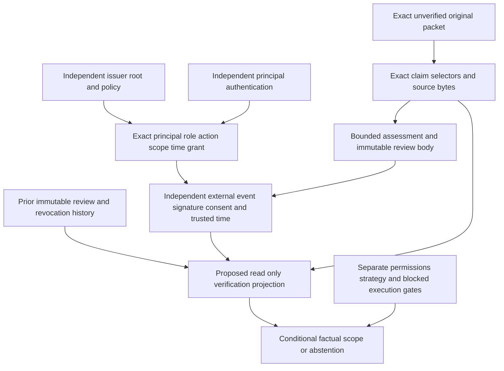

# Context-evidence reviewer authorization and append-only review design v1

**DESIGN ONLY. No reviewer has been authenticated or authorized by this package.**
The current implementation remains `AUTHENTICATION_NOT_IMPLEMENTED` and
`AUTHORIZATION_NOT_ESTABLISHED`. Every example, including the complete hypothetical
chain, is `ILLUSTRATIVE_ONLY`. No example is an actual reviewer decision.

This package defines the smallest future boundary through which an independently
reviewed contextual claim could acquire a precisely scoped factual disposition.
It implements no login, approval command, evidence promotion, persistent review
store, signature verifier, authorization service or current-status projection.
No governing architecture or owner semantic decision is changed.

This design authorizes neither the review-lineage inspector nor any authentication
implementation. Both remain deferred pending an owner-approved product-delivery
priority decision; a technical option ranking is not implementation authorization.

Canonical base: `cd5c15b9238cd051ecbb7e164ba2cdac744ae03c`, tree
`98177d19fbd09f4c692f5de590c850a9bb9a7e7a`. GitHub main and merged PR #227
were independently verified. Its ordered parents are
`2ea55791a8267c4c6f178c921fa6f1ddebc27b9f` and reviewed head
`2eb0fb7ba318d52736b557c05d61b569fe90bd0e`. A clean checkout was reconciled
with the exact signed canonical commit before creating
`codex/reviewer-authorization-design-v1`. No AGENTS.md was present in the
repository or its workspace/root ancestors. Architecture v13 ACTIVE APPROVED,
Decision 017 ACCEPTED and repository-first governance remain binding.

### Bounded audit correction and identity succession

The prior draft package at head
`15914174f718a11d2bab97491c6ebd5716bc63ab` had identity
`sha256:7431c2c7a4197a0d1b1d2024482b068688171a19a7d55622690f25e3903a1291`.
It remains in Git history. This audit correction updates the owning-contract
inventory, historical source bindings, reuse rationale and documentation only,
with directly necessary design-consistency tests. Its new content identity is
recorded in `manifest.json`; it is not the previously reviewed draft package.
The proposal schema, decision model, twelve illustrative records, original packet
IDs and complete runtime/workflow inventory remain unchanged. No baseline defect
in deck allocation or generic evidence-review validation is repaired here.

## Package and owning evidence

| Artifact | Purpose |
|---|---|
| `inventory.json` | Actual owning modules/APIs, inputs, authority boundaries, gaps and provider investigation; implemented capabilities remain distinct from proposals. |
| `source-bindings.json` | Exact inspected source/evidence paths, byte lengths, raw hashes, modes, canonical base/tree and existing policy/decision/packet identities. |
| `contracts.schema.json` | Closed bounded JSON Schema proposals for claim selectors, authorization, review body, external attestation, authority revocation, projection inputs/outputs and illustrative examples. These are not operational admission schemas. |
| `design.json` | Finite authority layers, role/actions/statuses, evidence graph, append-only cases, threat responses, proposed projection and ranked future options. |
| `examples.json` | Twelve illustrative scenarios; exact original unverified packet IDs and one explicitly illustrative corrected submission through the unchanged packet contract. |
| `runtime-preservation.json` | Every inherited runtime/workflow path, mode, Git blob and raw digest from exact canonical main; no runtime addition or edit. |
| `manifest.json` | Immutable closed file inventory and domain-separated package identity, including this README. |

The independent package identity is in `manifest.json` and pinned separately by
the test. Canonical JSON is sorted, compact UTF-8 with exactly one trailing LF;
duplicate keys, nonfinite values, floats and non-JSON types reject through the
existing strict contract. Raw file digests include all bytes, including the LF.
The domain-separated identity uses the existing `card_rules_pilot.contract`
domain/content envelope and excludes only its own identity field and the final
envelope LF. Changing an example and coherently rehashing the package produces a
different package, which the independently pinned test rejects.

Checksums establish integrity only. The package pin establishes which design
was reviewed; it does not authenticate a human, prove a source, authorize a
review event or grant legal permission. A future operational contract needs
separate owner authorization and an explicit runtime version; a proposal cannot
be made operational by renaming or wrapping it.

The immutable existing contracts remain authoritative:
[context packet](../../CONTEXT_EVIDENCE_REVIEW_PACKET.md),
[requirements](../../STRATEGIC_CONTEXT_REQUIREMENTS.md),
[six-land overlay](../../SIX_LAND_EVIDENCE_OVERLAY.md), and
[approved integration design](../rules-card-intelligence-v1/README.md).
Actual read-only admission remains `load_context_evidence_review`, through the
public requirements/overlay/accepted-decision readers. Example JSON is used only
as unverified illustrative submission material, never as accepted semantics.

## Exact scope and verified capability inventory

Only `variable-output`, in namespace `magic:legacy-promoted:card`:

| Card | Exact Card ID | Existing accepted subject |
|---|---|---|
| Cabal Coffers | `7358e164-5704-4e78-9b21-6a9bf2a968ce` | `coffers-mana` |
| Snow-Covered Wastes | `46a07b53-ff58-4bd6-80dd-ded2eb0e29a3` | `snow-wastes-mana` |

The four existing categories remain hypothetical deck composition, objective/mana
requirements, format/legality leads and performance/comparison leads. No new
Card, Printing, interpretation, source, category, question family or role
classification is introduced. A contextual reviewer role proposed here is an
authorization capability, not a functional Card role.

The packet still allows at most four candidates; all claimed origins, dates,
deck/version labels, content/digests and permission statements remain unverified.
The old packet IDs and bytes never change. Supplied deck land quantities are not
controlled Swamps. Coffers retains `{2}, {T}` and an unspecified controlled-Swamp
dependency; Wastes retains its fixed written output. No actual/net mana,
payment, break-even, subtype inference, deck consistency or legal activation is
calculated by this design.

The exact owner semantic decision remains
`sha256:648ebea0994f5d400664b35db6fcd5bcbc7feadeb0d28e039ecd55ed0c243075`;
accepted collection
`sha256:73bbedd05ae01f4869cbf7aeed2c4f5f95d624a7c19a2f31d0bd4a106ac9fc7e`.
Only the existing bounded historical retained-text semantics are accepted; all
original pending interpretation records remain historical. The original empty
requirements report is
`sha256:47b134c21c5a54087ed29e6c70b06a5591e60958f38e2db4c759d1bafb71cedd`.
Exact current schema/policy and historical source bindings are retained in the
machine-readable package; no source identity is inferred from a Card name.

| Existing implementation | Actual boundary; reuse permitted only as a pattern |
|---|---|
| Context input/review and strategic requirements | Strict immutable supplied records, owned complete packets, exact expected-report recomputation, triage and integrity-checked detail routes. No authenticated reviewer, approval or evidence promotion. |
| Six-land overlay and fixed owner semantic decision | Exact Card/dossier/provider/Printing and candidate/decision evidence; not a contextual authorization issuer or generic approval service. |
| `AdmissionReviewBoundary` / `AdmissionDecision` | Trusted-host capability protocol; the host must supply authentication and access control. The module explicitly implements no authentication service. Untrusted input cannot select the capability. |
| `IsolatedAdmissionTestBoundary` | Nonserialized, lifetime/root-bound disposable test capability. Its simulated approval cannot be retained or transplanted as contextual authority. |
| Collection assessment history | Snapshot/claim correspondence, explicit predecessor/supersedes, exclusive append and readback patterns. Trusted-caller and review-label assumptions are collection-specific; no contextual principal verifier. Writers are inspected, not invoked. |
| Product evidence packet human review | `EvidencePacketEligibility`, `EvidencePacketReview`, `review_evidence_packet` and `require_ready_evidence_review` separate automated eligibility from explicit caller-supplied human attestation; they bind exact packet identity and the reviewed freshness window. The trusted caller owns authentication and the durable review reference. A supplied reviewer name, `human_approved` flag or READY result is not independently verified reviewer authentication or contextual authority. |
| Evidence handoff / production candidate review | Deterministic integrity/completeness/conflict checks; production candidate review is explicitly signature-free. Software review is not a human-review event. |
| Rules artifact correspondence | Explicit owner-origin/reviewer annotations with cryptographic authentication and source permission unestablished. A source-correspondence annotation does not authenticate a contextual reviewer. |
| Reviewed usage/demand readers | Scope-bound market-fact readers, not a transferable reviewer-identity provider or evidence of Card strength. No market fact is added here. |
| Immutable snapshots and Tier A permission closure | Content/scope/schema/policy/capability and operation/use boundaries; source and production permissions remain independent. No contextual principal registry or login. |
| Git and hosted workflows | Public code/design history and software validation. A commit author, merged PR or passing workflow is not proof that a specific contextual review was authenticated or authorized. |

The bounded repository investigation found **no implemented suitable contextual
authentication provider, reviewer grant issuer or trusted principal registry**.
This is not a claim about undisclosed external services. The GitHub connector
used for repository work authenticates repository operations; it does not
authenticate the hypothetical reviewer events in this design. Existing patterns
from other subsystems are not automatically authorized for contextual evidence.

### Reuse versus separation

| Existing boundary | Reusable mechanics | Trust assumption and authority that cannot transfer |
|---|---|---|
| Production admission: `AdmissionReviewBoundary`, `AdmissionDecision`, `AutomaticCanonicalUpdate._authorization` | Trusted-host capability injection; exact operation/reviewer/evidence bindings; repeat integrity and authorization checks on resumed writes. | The host supplies authentication/access control. An existing `canonical-admission` decision, serialized receipt or isolated test capability cannot authorize contextual review. Reusing the architectural capability pattern requires separately authorized contextual actions and exact claim scope. |
| Collection: `CollectionAssessment._review`, `validate_assessment_history`, repository `append` | Source/snapshot correspondence, immutable predecessors, identical replay and exclusive append patterns. | `trusted_human_review` is a trusted-caller assertion, not an authenticated principal. Collection history rejects forks; contextual review must retain incompatible individually valid branches and abstain. Collection approval cannot approve contextual claims. |
| Product packet: `review_evidence_packet`, `require_ready_evidence_review` | Separate eligibility/attestation; exact packet and as-of/freshness binding; recompute eligibility before stronger use. | The caller supplies human attestation; the module neither authenticates the reviewer nor signs/publishes review. READY_FOR_EVALUATION is bounded Product evidence eligibility plus attestation, not contextual factual acceptance, permission or Card semantics. |
| Generic evidence: `review_handoff` | Integrity, declared-reference coverage, duplicate detection and contradiction findings, subject to each owning input contract. | Software findings and Ready for verification are neither human authentication nor factual/source approval. Context review needs its own exact scope, authority and non-promotion boundaries; generic labels cannot supply them. |
| Contextual reviewer proposals in this package | Reuse those mechanical patterns through owning public contracts rather than a parallel evidence pipeline. | Claim-scoped authorization, review-event proof, revocation and historical/current-use separation are proposed only. No provider, trusted issuer, approval command or operational projection exists. |

The machine-readable inventory records the same five boundaries. This is an
architectural reuse analysis, not a new shared runtime abstraction or a grant of
authority. Whether a separately authorized trusted host can satisfy contextual
review requirements, and which issuer, event proof, time and revocation evidence
it would use, remain unresolved. No separate authentication service is mandated
or implemented by this correction. Caller trust flags are never silently upgraded
to independently verified contextual reviewer authority.

### Historical authorization loop: Phase 117, 117A and 118

These exact commits are ancestors of canonical main; `source-bindings.json`
records the inspected historical contract paths, Git blobs, byte lengths and raw
digests. These are historical source references, not retained authorizations.

| Historical change | Exact repository commit and affected contracts | Responsibility and limit |
|---|---|---|
| Phase 117 implementation | [`2d072b883c5a6f3c1b16c11d652e62f6d7756f6a`](https://github.com/IDontFeelNone/MTG-Lab/commit/2d072b883c5a6f3c1b16c11d652e62f6d7756f6a): `src/production_evidence/operator_authorization.py` (`verify_review_chain`, `build_signature_request`, `record_authorization`); `scripts/authorize_mb2_batch.py`; Phase 117 request/contract artifacts. | Reconstructed the exact Phase 115/116 MB2 batch evidence, pinned candidate and canonical pre-state digests, validated supplied operator fields and recorded one immutable non-promoting authorization with identical replay/conflict checks. Input syntax and checksums did not independently authenticate the operator. |
| Phase 117A workflow/persistence | [`83ba0c2157b5771562d330dfc97cd691fd04cfbe`](https://github.com/IDontFeelNone/MTG-Lab/commit/83ba0c2157b5771562d330dfc97cd691fd04cfbe): `.github/workflows/mb2-operator-authorization.yml`, `scripts/mb2_authorization_persistence.py`, updated `operator_authorization.py` including `verify_authorization_artifact`. | Added manual workflow dispatch, dry run, exact batch/branch checks, authorization-only persistence and readback. Operator identity/role were submitted input strings, not bound by that workflow to `github.actor`; its artifact verifier established content/lineage correspondence, not cryptographic principal authentication. No actual authenticated review event is asserted here. |
| Phase 118 removal | [`55ac1563e82651d03759f94f44de3124e81afd58`](https://github.com/IDontFeelNone/MTG-Lab/commit/55ac1563e82651d03759f94f44de3124e81afd58): removed the authorization module, both persistence/authorization scripts, workflow, active Phase 117 artifacts and tests; added `src/production_evidence/promotion_readiness.py` (`evaluate_review_gate`, `build_promotion_plan`). | Operator signatures ceased to be prerequisites for that trusted-source MB2 promotion. Trusted-source validation, normal PR review and green CI supplied oversight; promotion remained separately invoked, bounded, audited and rollback capable. The contemporaneous `docs/PROJECT_STATUS.md` states this replacement explicitly. |

**Historically repeated mechanics:** exact evidence/subject membership, canonical
content identities, immutable non-promoting records, independently reconstructed
content/lineage correspondence, identical replay and conflicting-byte rejection.
These are precedents to reuse, not new authentication capabilities to rebuild.

**Genuinely new contextual requirements:** dispositions over exact submitted
claims rather than an entire trusted-provider promotion batch; explicit reviewer
action/claim/deck-version scope; independently verified authority at event time;
issuer/grant expiration and revocation; corrected-submission and review lineage;
retaining incompatible valid reviews; and historical-event validity separated
from current-use eligibility. Existing personal-assessment and product-attestation
states do not establish these stronger properties.

Phase 118's removal is not a universal prohibition on contextual review, and it
does not authenticate arbitrary owner-supplied material. Conversely, unverified
context does not justify automatically reinstating the abandoned operator gate
or requiring authorization-only branches, signature artifacts or an identity
service for unrelated product delivery. The product need and operational trust
mechanism require an explicit owner-approved delivery-priority decision. This
design records those unresolved choices; it cannot satisfy or authorize them.

## Nine separate authority layers

| Layer | Identity / evidence | What it cannot imply |
|---|---|---|
| Submission | Exact original packet/candidate bytes, supplied content and claim selectors; unverified declared scope/provenance. | True facts, an authenticated submitter, current source authority or permission. |
| Submitter | Claimed source/origin; any future independent identity proof must be separate. | Authenticated authorship from a name, username, pasted signature or owner text. |
| Reviewer | Claimed principal namespace/ID, distinct from independently authenticated event identity. | A role, authorization, consent or an actual review merely from the identity string. |
| Authorization | Independently trusted issuer grant for exact principal, role, action, scope, period and revocation state. | Whole-system owner authority, another category/deck version, source rights or a self-issued grant. |
| Assessment | Exact claims/source snapshots, bounded method, findings, counterevidence and unresolved conditions. | A verified decision without independently established reviewer authority and action. |
| Decision | Narrow factual disposition over precisely assessed claims, if its event and all relevant gates are proven. | Actual world/deck facts beyond verified source/date/version scope or strategic strength. |
| Permissions | Separate source-policy, retention, redistribution, service and AI-export evidence. | Any legal/use clearance from a factual review or checksum. |
| Strategy | Independent appropriate analytical/performance validation. | Advantage, consistency, recommendations or confidence from a reviewed contextual declaration. |
| Gameplay | Separate semantic closure, execution readiness and authorized state. | Canonical executable semantics, payment, activation, actual mana or simulation from context review. |

There is no `approved=true` shortcut. The proposed record's disposition, an
independently verified event's validity-at-event-time, current-use eligibility,
source verification, permissions, strategic validation and execution authority
are separate dimensions. No field's presence is evidence that its gate passed.

## Proposed reviewer authorization contract

The proposed principal namespace is `mtglab:context-review-principal:v1`, and the
issuer namespace `mtglab:context-review-authorization-issuer:v1`. These are
**reserved proposals**, not established registries. All examples use explicit
`illustrative:` principal/issuer identities. The actual trusted issuer list is
empty. A name or UUID shape never establishes membership.

Finite reviewer roles and actions are in `design.json`: a factual reviewer can
inspect submissions, assess declaration correspondence/provenance completeness
and issue a factual assessment. A history reviewer can inspect and issue
explicit supersession/invalidation actions. Issuing/revoking grants is a
separate issuer action, not a privilege automatically held by either reviewer
role. Owner status is not inferred from Git, a PR, a label or a test.

A future independently verified authorization must bind:

1. A stable principal namespace and identity proven by a separately authorized
   provider, with authentication provenance/assurance and intended audience.
2. The independently authorized issuer, its delegated action authority and an
   exact immutable trust-root/policy snapshot. No untrusted request installs a
   trusted issuer, host capability, provider adapter or key.
3. An explicit role and permitted review action, scoped to the exact question,
   Card/subject IDs, category, packet/candidate/claim and strategic-requirement
   IDs, affected predecessor review IDs, declared deck/version, and operation. No wildcard or implicit scope
   inheritance. A corrected packet requires new explicit coverage.
4. Reliable effective-from/effective-until provenance, independently trusted
   event time and explicit evaluation time. Claimed timestamps alone establish
   no validity period. Missing temporal proof blocks authorization.
5. Independently verifiable issuance, reviewer event/consent and key/principal
   binding; current and archived issuer/key/grant revocation evidence.
6. The exact review record and domain-separated event payload, including
   action, scope, grant, principal, nonce and audience/verification policy.

The signed payload proposal in examples deliberately contains **no signature,
trusted timestamp, issuer proof or revocation receipt**. The complete chain is
a concept only. A real implementation must independently verify those items
through approved adapters, not accept a pasted proof or a caller-selected
`verified` flag. Passing tests cannot issue an authenticated event.

At decision time, a future verifier would have to establish issuer/root trust,
principal authentication and consent, exact role/action/scope, effective period
and nonrevocation at a trusted event time. The archived event must retain enough
permission-bounded immutable key/issuer/algorithm/policy/time/revocation evidence
to reproduce that conclusion later. At later use, current trust and revocation
must also be checked under an explicitly supplied evaluation time and policy.
No online source acquisition or provider integration is authorized now.

## Proposed immutable review body and external event

`contracts.schema.json` defines proposal domains, not a runtime admission path:

| Record | Proposed domain and bindings |
|---|---|
| Claim selector | `context-evidence-review-claim-selector-proposal-v1`: exact packet/candidate, finite JSON pointer, value digest, scope digest and bounded proposition about the retained declaration. |
| Authorization | `context-evidence-review-authorization-proposal-v1`: principal, role/action, exact scope, issuer/root provenance, effective interval and issuance/revocation references. |
| Review body | `context-evidence-review-record-proposal-v1`: original packet digest, exact candidates/claims/submission/content identities, requirement IDs, claimed versus independently verified source refs, reviewer/grant, assessment, findings/counterevidence, disposition, conditions, provenance and predecessor identities. |
| External event | `context-evidence-review-attestation-proposal-v1`: explicit audience and verification-policy-proposal ID, body ID, grant, principal, action, scope digest, unique request nonce, signed-payload digest and independent signature/time/issuer/revocation evidence references. |
| Authority revocation | `context-evidence-review-authority-revocation-proposal-v1`: exact grant, independently authorized issuer, effective versus recorded time, prospective/retrospective effect, reason and prior revocation reference. |
| Future projection | `context-evidence-review-current-status-proposal-v1`: exact admitted input-set/lineage and verification-policy identities, explicit trusted evaluation time and separate historical/current statuses. **Not implemented.** |

Claim value/scope digests use the exact canonical JSON value including its LF.
Each submission-identity row also names its exact packet, preventing candidate
membership from being borrowed across submissions. A history action requires
explicit grant coverage of the affected predecessor IDs, never implicit scope
from a newer record. Supplied source-content digests retain the existing raw UTF-8 byte rule with no
newline/Unicode normalization. The distinction is explicit; a field-value hash
cannot substitute for original source bytes. Claim selectors are not canonical
Card abilities or new semantic interpretations.

A review body has no embedded signature over itself, avoiding circular IDs.
The external event binds its independently computed body ID and exact scope;
its explicit audience is `mtglab:context-evidence-review:variable-output:v1`,
and its `verification_policy_proposal_id` names the exact `design.json` policy
proposal identity. Both fields participate in the signed-payload digest and
event ID. That policy proposal is still design-only, not an approved runtime
verification policy or a source of actual authentication. A future operational
version needs a separately approved policy/trust snapshot and verifier.
The grant binds the explicit scope, including affected predecessor review IDs,
but does not depend on the new review record's later-computed ID. The external
attestation binds both the grant ID and that new review-record ID and has its
own separate domain identity. Rehashing a body invalidates an old event's
binding; rehashing every document still cannot manufacture the independent
signer, trusted time, issuer authority or externally pinned original submission.

The examples' JSON fields use `model_status=ILLUSTRATIVE_ONLY`. Their actual
authentication and authorization fields stay unimplemented/unestablished, and
`actual_review_event` is null. Their proposed dispositions are not current
decisions. The source-reference arrays remain separately claimed and
independently verified; all independently verified arrays are empty here.

## Decision vocabulary and permitted conclusion

The existing packet supplies `SUBMITTED_UNVERIFIED`; no review record is needed
to fabricate an event for an unreviewed packet. Proposed dispositions are:

| Disposition | Precisely bounded meaning, only if independent gates are satisfied |
|---|---|
| `INSUFFICIENT_EVIDENCE` | Identifies what was assessed and why source/content/method/scope cannot substantiate the claim. |
| `CONTRADICTED_BY_ADMITTED_EVIDENCE` | Binds exact independently admitted counterevidence; disagreement is scoped, not an automatic source preference. |
| `OUT_OF_SCOPE` | The attempted assessment falls outside the question/category/claim or reviewer grant. It establishes no underlying fact. |
| `REVIEWED_WITHIN_FACTUAL_SCOPE` | Only the explicitly assessed factual proposition about exact verified source/date/deck-version evidence; never general acceptance. |
| `SUPERSEDE_PRIOR_REVIEW` | Explicit authorized successor action naming affected predecessors/claims; earlier bodies remain unchanged. |
| `INVALIDATE_PRIOR_REVIEW` | Explicit authorized factual/error correction action over named earlier claims; separate from revoking a principal's grant. |

The finite authentication, authorization and projection vocabularies are in
`design.json`; they do not infer authority from these disposition strings.
An old record's disposition is never mutated to `SUPERSEDED` or `REVOKED`.
Those are lineage/current-use annotations derived only by a separately
authorized future projection over independently verified append-only events.

For example, a carefully bounded factual proposition could be: **the exact
retained hypothetical declaration contains total_lands=36 and
claimed_swamps=20**. It is not: the real deck has those quantities or any Card
has a Swamp subtype. The independent reviewer still needs authenticated action
and appropriate source proof before even that bounded disposition has review
authority. The current packet already checks structural equality/integrity;
this proposed human-review layer would not turn that checksum into truth.

No disposition can establish actual battlefield counts, payment feasibility,
legal activation, actual/net mana, deck consistency, legality without separate
authoritative format evidence, performance without independent strategic
validation, Card strength/superiority, current Oracle accuracy from historical
text, production identity, source-use permission or executable gameplay semantics.
All existing strategic requirement statuses remain unchanged by this design.

## Append-only correction, supersession and revocation

An original packet is immutable. A corrected assertion produces a new candidate
and packet through the unchanged input contract. Its connection to the original
is an external proposal's `prior_submission_packet_ids`; the packet schema is
not extended or rewritten. A new assessment references earlier review IDs and
requires fresh explicit authorization covering the new exact claims/packet.
Merely referencing a predecessor does **not** supersede it.

Each later review body references its predecessor(s), at most two for an
explicit reconciliation. The future consumer needs complete acyclic bounded
ancestry. Records are content addressed; same ID/different bytes rejects.
Duplicate identical records/events are idempotent and never independent votes.
Same nonce with a different payload rejects. The current design implements no
append writer, transaction, lock, store, service or lineage projection.

| Change | Append-only action and historical/current distinction |
|---|---|
| Corrected claim | New submission and review; preserve original packet/candidate/review bytes and explicit cross-submission links. |
| Source contradicted | New scoped assessment plus admitted counterevidence; preserve both sources and abstain where unresolved. |
| Reviewer error | Separately authorized factual correction/invalidation naming affected earlier claims. |
| Grant expired | No new action/current use under expired authority. A proven valid-at-issuance event can remain historically valid, but current use needs fresh authorization/revalidation. |
| Prospective revocation | Issuer-authorized grant event blocks new/current use. It does not rewrite a historical factual disposition or erase a proven earlier event. |
| Retroactive key/issuer compromise | Explicit independently verified retrospective interval/reason can make event-time authority invalid or unresolved; quarantine affected claims while preserving all event bytes. |
| New deck version | Independent packet/version scope and fresh review/grant; no automatic transfer from the previous version or deck label. |
| Incompatible valid reviews | Retain both event-time-valid branches and source claims. Current status abstains until an explicitly authorized reconciliation references relevant parents and claims. |
| Replay/duplicate | Idempotent exact identity, or rejection for changed payload/nonce/audience; no corroboration count. |
| Original evidence changed | Reject substitution; a coherently rehashed change is a different unreviewed submission, never covered by an old event/signature. |
| Source content unavailable | Retain lawful metadata/proof history, but return EVIDENCE_UNAVAILABLE for stronger/current use; never reconstruct a source from a summary or hash. |
| Missing/cyclic ancestry | Quarantine; do not guess parents or repair history from timestamps/Git order. |

An issuer's authority revocation and a reviewer's factual supersession are
different event domains/actions. Neither automatically implies the other.
Disputed effective time, delegation or retroactivity requires independent review
and abstention, not a local choice of the newest timestamp. Revocation history
must retain both the asserted effective time and when the event was recorded,
with independently verified provenance for each relevant temporal conclusion.

## Proposed read-only current-status projection — not implemented

Inputs would be the exact submitted packet/claim set, complete immutable
review/grant/attestation/revocation/source evidence set, approved trust-root and
verification-policy snapshots, explicit independently trusted evaluation time,
consumer scope and any separately required permission/production evidence.
No default wall clock or caller's timestamp proves time.

The ordered design requirements in `design.json` are declarative specifications:
admit exact original evidence; verify closed schemas and complete acyclic
lineage; independently prove event/principal/issuer/role/action/scope/time and
event-time revocation; separately check current authority; retain incompatible
valid branches; assess only the exact independently supported factual claim;
and keep permissions, strategy and execution blocked unless their own separate
systems establish them. With today's implementation it must stop at missing
authentication/authorization, even when every proposed field is present.

Output would include exact input-set/lineage identities, applicable/ineligible
and conflicting claim/record IDs, missing proofs, deterministic reason/status,
historical validity-at-event-time and current-use eligibility. Sorting is by
canonical identity for reproducibility, not authority. `CONDITIONAL_FACTUAL_SCOPE`
is a proposed status with independent proof prerequisites; it is not today's
result. No confidence score, power rank, ready-for-recommendation flag, current
status service or executable approval path is implemented by these documents
or their tests. Proposed finite bounds are 16 records, two parents per record,
eight claims and four candidates per record, and two packets per scope. These
do not alter any inherited runtime bounds.

## Provenance graph

Every transition's required gate is also machine-readable in `design.json`.
No arrow is a currently implemented authorization or source-verification path.

## Threat model and fail-closed behavior

The machine-readable threat matrix covers forged reviewer/owner identity,
unauthorized role, scope escape, fabricated source authentication, permission
forgery, original-evidence and review-body rehashing, replay/duplicate events,
missing/cyclic ancestry, conflicting chains, expiry/revocation, evidence changes,
strategic/gameplay promotion, issuer/key compromise, absent sources, untrusted
time/wildcard grants and partial/concurrent append.

Structural/schema/identity and signature/nonce mismatches require rejection.
Out-of-scope, incomplete/cyclic lineage, trust compromise and incompatible
otherwise valid chains require quarantine and/or abstention. Source absence,
uncertain time/current authority and unresolved review conflict require explicit
missing-proof findings and independent human review. None is silently repaired.
An unauthenticated record can be inspected as an unverified claim, not admitted
as a legitimate decision. No timestamp, Git head or checksum selects authority.

## Twelve illustrative scenarios

All twelve use original packet IDs from the unchanged prior receipt or a new
strictly validated, explicitly illustrative corrected packet. They preserve
source claims and factual uncertainty. No real signature, trusted timestamp,
issuer trust proof, provider result, permission or reviewer decision is supplied.

| # | Scenario | Explicit boundary |
|---|---|---|
| 1 | Existing empty unreviewed packet | No fabricated review event; original strategic gaps remain. |
| 2 | Claimed reviewer identity, no authentication | Names/principal strings alone establish nothing. |
| 3 | Authenticated-principal concept, no grant | A hypothetical authentication assumption is not actual proof or authorization. |
| 4 | Proposed factual review of declared 36/20 quantities | At most exact declaration correspondence, if independent gates were proven; not actual deck/battlefield facts. |
| 5 | Performance lead without source content | Reference-only bytes absent; cannot substantiate the external claim. |
| 6 | Conflicting composition declarations | Retain both exact assertions; no automatic preferred source. |
| 7 | Corrected 38/20 hypothetical declaration | New candidate/packet ID, original packet and earlier review ID retained; fresh scope needed; predecessor linkage alone does not supersede. |
| 8 | Factual invalidation and prospective grant revocation | Separate event domains; preserve historical event and block current use where authority is absent. |
| 9 | Format review under composition-only grant concept | Scope mismatch; quarantine, never broaden the grant. |
| 10 | Permission/strategic-confidence promotion attempt | Forbidden promotion; no claim can cross those independent gates. |
| 11 | Coherently rehashed evidence/review substitution | Different content is a different identity; old pins/event cannot cover it. |
| 12 | Complete hypothetical authorization chain | ILLUSTRATIVE_ONLY at every level; signature/time/issuer/revocation proofs are absent and actual authority remains unimplemented/unestablished. |

Examples 2 and 3 distinguish a principal claim from an authentication assumption;
neither is a real identity proof. Example 12 binds the proposed body, claim scope,
grant/principal/action and unique nonce without fabricating any event signature.
All `independently_verified_references` arrays are empty. No example can be
imported through the existing packet contract as an approved review decision.

## Future options and exactly one recommendation

Engineering ranking concerns implementation readiness, not Card power or the
owner's product-delivery priority. All options remain deferred pending an
owner-approved product-delivery priority decision:

| Rank | Next option | User value / reuse / testability | Authority risk / complexity / prerequisites |
|---|---|---|---|
| 1 | Design-boundary verifier and read-only review-lineage inspector | High value: inspect exact bindings, broken ancestry and missing authority. High reuse of public packet/requirements/detail readers; finite adversarial tests. | Low authority risk if everything stays unverified; low to medium complexity; no new source acquisition or permission grant. |
| 2 | Manually governed append-only record implementation | Medium value before actual authority exists; reuse collection append/recovery patterns. Strong immutability tests, weaker real-authority tests without provider. | Medium to high authority risk and medium complexity; separate store/retention/operator governance and review issuance boundary needed. |
| 3 | Separately authorized authentication/authorization integration | High eventual value; necessary before real scoped decisions carry authority. Provider conformance and independent operational evidence required. | High risk/complexity; explicit trust roots, provider selection, issuer/delegation, security, keys/time/revocation and owner authorization. Existing host protocol is not a deployable provider. |

**Recommend exactly option 1, not authorized or begun:** one finite read-only
inspector for this question/two subjects, using existing public evidence admission
and separately supplied immutable proposal bundles. Verify schema/identity/
ancestry and report absent authentication/authorization. Exclude login/provider
integration, approval or decision issuance, persistent append store, source
ingestion, operational current-status projection, evidence/permission promotion,
strategic evaluation and gameplay. This gives independently testable visibility
before any review authority can be consumed. The tests in this design PR only
verify this one frozen package; they are not that general runtime inspector.

That conditional technical preference neither schedules nor authorizes the next
review-lineage inspector or any authentication implementation. Both remain
deferred pending an owner-approved product-delivery priority decision. No future
implementation begins through acceptance of this design or its audit correction.

## Verification, preservation and stop

Design tests pin this exact package independently; validate closed proposal
schemas and relationships, stable domain identities, exact original packet/
candidate/claim/requirement bindings, predecessor rules and authority-scope
mismatch; reject byte tampering, coherent rehashes and forbidden promotion;
and prove all examples remain illustrative with no authenticated event.
Actual existing public admission is exercised to corroborate source/requirement
identities. Under the actual incompatible writer-expanded catalog it must
reject; no substitute positive fixture or new skip is installed. Structural
example tests verify internal consistency, never actual reviewer authority.

All inherited runtime modules, Card/Printing evidence, submitted example packets,
accepted decisions, pending interpretations, requirements, rules projections,
market records, permissions and workflows remain byte-identical. Only this new
documentation package and new design-test file are added; no source-census
exemption, preservation-helper change, gate or timeout change is required.

Coverage remains 104 CR units / 16 projections / 24 retained land-context units.
`canonical_admission=false`; `execution_authority=BLOCKED`; semantic closure OPEN;
all ten activation responsibilities OPEN / EXECUTION_BLOCKED. Source-policy
clearance not granted. Private retention, redistribution, free/commercial service
and AI export NOT_ESTABLISHED; Tier A remains non-production. No strategic
scoring, recommendation engine, interaction generation, deck evaluation or
simulation is implemented. Historical matching does not establish current
Oracle, current identifier edges or operator-production identity.

Final head/tree/test-merge, focused/local/hosted validation and actual 654-card
writer/disposable publication/readback evidence belong in the single draft PR.
Stop for independent Senior PM review and final owner approval. No merge or
auto-merge, provider integration, operational reviewer approval or next milestone.

Future implementation milestone authorized: false  
Future source projection authorized: false  
Future milestone begun: false
