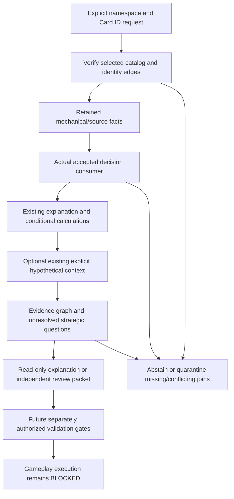

# Rules-to-Card-Intelligence integration design v1

**DESIGN ONLY — no integration runtime, admission API, strategic evaluation engine,
interaction generator or simulator is implemented or authorized.** This package
is an immutable repository audit and contract proposal for independent Senior PM
review and final owner approval. Passing structural tests establishes neither
semantic truth nor execution readiness.

Base: `9d89156cd14eedfb7b2c87cb89ac46fd1803b28d`, tree
`37b47af66d2a1a1a1570483cacabff06d3f360e6`. GitHub #223 is merged with ordered
parents `5cbe0425e7ff8d9d6f0c7f4859f48fea5bfe8cab` and reviewed head
`f653bc25cbf6025a51bc765a0241af5c56eb4bbb`; reviewed head and main have the
same required tree. Architecture v13 ACTIVE APPROVED and Decision 017 ACCEPTED
remain binding; repository-first governance applies. The public architecture
approval did not authorize real execution or permissioned production data use.
No AGENTS.md was found in the selected repository or its workspace parent.

## Package map and authority

- `inventory.json`: twelve verified subsystem inventories, owning files, APIs,
  schemas, inspected IDs, actual conclusions, input/authority bounds and gaps.
- `identity-joins.json`: exact six-Card/nine-subject matrix, provider versus
  Printing IDs, proof pointers and explicit identity abstentions.
- `source-bindings.json`: exact byte lengths and raw SHA-256 of inspected existing
  contracts/evidence. A file digest is an integrity binding, not a semantic review.
- `contract.schema.json`: proposed deterministic evidence-to-capability envelope;
  not registered with any runtime or canonical schema/admission registry.
- `examples.json`: four immutable illustrative proposal records, including the
  requested land questions. They do not establish strategic value or execute rules.
- `manifest.json`: separately versioned domain-separated immutable package ID
  over this fixed file inventory. Tests additionally pin the expected package ID,
  so rehashing modified contents and their enclosing manifest cannot admit them.

All JSON is canonical UTF-8 with a final LF. Package identity uses domain
`rules-card-intelligence-integration-design-v1` and excludes only `package_id`.
Example identities use domain `rules-card-evidence-design-example-v1` and exclude
only `design_record_id`. These are design identities, not accepted candidate,
KnowledgeFact, owner approval, production snapshot or executable-semantic IDs.
The proposed record's schema version is
`rules-card-evidence-contract-proposal-v1`. No new public runtime consumer exists.

## 1. Verified subsystem inventory

The machine-readable inventory supplies exact IDs and file references. Its
read-only flag describes supported composition paths, not permission to execute
all methods of an owning class or to use the subsystem in production.

| Subsystem and owning contract | Implemented inputs and reliable output | Boundary / missing capability |
|---|---|---|
| `repository.cards`, `canonical.models`, `query.CanonicalQueryEngine`, `repository.legacy_profile` | Exact type/ID resolution, typed seed Card/Printing records, legacy promoted-state references, verified catalog attachment and query snapshot | Tier A catalog/query/collection compatibility; production eligibility false. Separate typed IDs and legacy UUIDs must not be equated by name. Operator snapshot is not established for this cohort. |
| `card_intelligence.mechanics.MechanicalCardIntelligence` | Attachment + independent query pin + retained acquisition; exact dossiers and literal descriptive fields for 384 Cards | Historical provider evidence, not current Oracle, semantic parsing, legal action or strategic strength. `from_attachment` supports one shared query chain. |
| `FunctionalRolePilot.from_mechanical` | Exact fifteen-Card plan/vocabulary and explicit authored role proposals, counterevidence, limitations and dossier/report IDs | Requires review; no automatic classifier or KnowledgeFact admission. Zero land members; source text containing mana does not create a land role candidate. |
| `ContextualCardComparisonPilot.from_roles` | Ponder, Faithless Looting and Greater Good under a declared context; descriptive calculations and unverified hypotheses | Three-Card pilot only. No verified timing, net card advantage, land coverage, universal winner or interaction correctness. Shared reader chain is supported. |
| `CanonicalCollectionResolver`, `CollectionAudit` | Exact Printing/identifier resolution and ambiguity, source-reported holdings, snapshots, review history, duplicate/shortfall arithmetic and bounded audit context | Reported ownership is not inferred real inventory or deck quality. Retained audit collection is fictional. Select read-only build/verify/query methods; `create_snapshot`/service writers are excluded. |
| `CardAcquisitionAdapter.from_mechanical`, `CardValueExplanationEngine` | Source-bound finite buyer/ownership/offer analysis; evidence-first ten-Card printing/market/demand/usage explanations | Retained real acquisition example abstains and `actual_purchase_advice=false`. Synthetic selection is not real purchase advice. Demand/usage/competitive data is not proof of gameplay value or a land cohort extension. |
| `gameplay_rules.source_evidence`, `.projection`, `card_rules_pilot.land_context` | Verified retained metadata/packages, 104 CR units / 16 projections globally; 24-unit land context | No new source inspection/projection; no fresh CR verification, complete semantics, ordinary broad-603 procedure or real execution. |
| `land_authored`, `land`, original reasoning/behavior/effect policies | Nine complete owned subjects, criterion/method inputs, conditional classifications and behavior, additional-effect composition | Original records stay PENDING_NOT_ESTABLISHED. `load_lands` alone never supplies current acceptance. Local subject IDs are not canonical ability IDs. |
| `land_decision.load_land_decision` | Actual source/catalog/interpretation admission plus exact immutable owner decision; current bounded acceptance of nine candidates | No new semantic approvals, signatures or account attestations. Historical pending records remain unchanged. Not executable CardGameplaySemantics. |
| `land_explanation.load_land_explanations` | Closed nine-subject/six-Card/four-group concise explanation, costs, restrictions, procedure, unknowns and verified detailed route | Capability difference is not a strategic advantage. No Card parser, rating, deck recommendation or gameplay. |
| `mana_scenario.load_mana_scenarios` | Explicit count 0..1,000,000 or canonical WUBRG subset; missing/zero/empty/conflict separation; written output/choice only | Assumptions are not observations. No actual/net output, payment, commander inference, target, damage or legal action. One admission serves a batch. |
| Product models/readers, `AnalyticsService`, fictional `GameplayRulesEngine`, execution-design packages | Pack/Slot/Sheet/product contracts and validation, fixed-content product arithmetic and analytical summaries; a deterministic fictional-only gameplay interpreter | `src/simulation` contains only `.gitkeep`; `src/probability` only its non-executable package declaration. No pack sampler, real Card-interaction engine or deck-performance simulator was found. Fictional execution cannot consume real land readings. |

### Inspected subsystem identities

The exact profile is
`sha256:71b8879ced8fe7203aa69755bec411f0160a7c0011fdc768976c2113df600d3e`;
query snapshot
`sha256:7cee417d40186169829d812c1edd4db6d6934f75f3eeb7183dae09f61bb437a7`.
Its permission closure ID is retained in inventory, with approval_state
not_granted, production_eligible=false and mechanical_evidence outside Tier A.
The bounded private mechanical/rules pilots check their additional retained
evidence independently; they do not change those profile permissions.

Mechanical cohort report:
`sha256:1765aac6a958f5a9bd3d7d063eee07deae82fd953fc7ba8f76ae2d6c79ec2857`.
Functional-role report:
`sha256:6d6bed4e7fa41bc77834d0731516bf4efafa8d6fc5100269e70c4a1fca2c775e`.
Contextual-comparison dossier:
`sha256:147ef342300b01aa94d37cfd07f2b15cd4b1b40d30f9da29b1365ec7dd24254f`.
Collection audit `bb2b8c2a519fcdf039d669ef`, digest
`5fcde547ae257fce54da214f11863845d8472b46f74d309b014c4c43f1ef82fe`.
Retained real acquisition dossier:
`sha256:e3c61a6e9cdedcfa437af4cf9b01bc3bea737491bac1e192d8081501cfbc58da`.
These identities bind their different owning formats; do not rehash all of them
with one guessed algorithm or treat an ID as a source-authority certificate.

Exact land owner decision:
`sha256:648ebea0994f5d400664b35db6fcd5bcbc7feadeb0d28e039ecd55ed0c243075`.
Accepted collection:
`sha256:73bbedd05ae01f4869cbf7aeed2c4f5f95d624a7c19a2f31d0bd4a106ac9fc7e`.
Plan `sha256:0f72e8aeed7b2d57a5ae4a562183233079c48170e69d5df5831a96b951e4fdd5`;
land context `sha256:59eb902055e8f597f9b0761ac176ad37406365c53a87098e3dcf621a1c5df478`.
Accepted explanation policy:
`sha256:4eefb8ceb34fb5799823d4a2881c897e6903f7eb2f3a2c5c4596ca7f854d2d6c`.
Hypothetical policy:
`sha256:e31393a947305efe46abe207ef951209dc47898ceb6ad917a1da5db900f15149`.

The functional-role report and contextual comparison IDs above were reproduced
through actual `FunctionalRolePilot.from_mechanical` and
`ContextualCardComparisonPilot.from_roles` using the live explicitly attached
catalog. The collection audit was reconstructed with its owning source/snapshot/
assessment contract, and the real acquisition packet was evaluated through the
existing adapter; both reproduced the retained IDs, with acquisition advice false.
These were read-only audits of existing capabilities, not a new integrated runtime.

## 2. Exact identity correspondence

An exact Card ID match exists across all six land dossiers, Scryfall Oracle IDs,
legacy promoted Card records and the attached canonical query. This was checked
through actual land/scenario admission and independently through the owning
catalog query, never by Card name. Names below are display labels only.

The attached catalog has **399 Cards / 928 Printings**: 15 typed seed Cards and
15 seed Printings, plus legacy state 384 Cards and 913 Printings. Typed-first
precedence is exact entity type/ID. None of these six UUIDs is in the separate
15-Card typed seed namespace. There is no admitted operator-production snapshot
for these land identities. Historical promoted-state identity is real evidence;
it is not permissioned v13 production eligibility.

| Display label | Exact legacy Card UUID | Retained Scryfall Printing/observation ID | Exact historical MTGJSON Printing UUID | Current catalog scryfallId edge | Total legacy Printing membership |
|---|---|---|---|---|---:|
| Snow-Covered Wastes | 46a07b53-ff58-4bd6-80dd-ded2eb0e29a3 | 3bce79b7-f964-4442-b3db-3ecffbba8d92 | 7d33713f-d665-53c5-b64c-6f231f87da02 | promoted | 1 |
| Rishadan Port | f3e8dc56-2810-474e-a6a7-9c3555f94ae9 | 125de79a-2b28-45ac-a066-92a9b73c3cb8 | 6c27e26c-a874-5c4d-99eb-ee4631b5bb0c | IDENTITY_NOT_ESTABLISHED | 1 |
| City of Brass | f25351e3-539b-4bbc-b92d-6480acf4d722 | 10eb8117-c009-4d50-b3fb-4879081f38be | c5303dc2-a1e9-595c-a64c-dff67a63c2a5 | IDENTITY_NOT_ESTABLISHED | 1 |
| Tarnished Citadel | 66ae2562-68e9-4c77-ba0a-57f8ff37f656 | ab2f8d97-a77e-4a99-ac54-f4fd5b5d6571 | 6c3d86fb-e909-5234-be5d-52ba8b0983b4 | IDENTITY_NOT_ESTABLISHED | 1 |
| Cabal Coffers | 7358e164-5704-4e78-9b21-6a9bf2a968ce | 0b1cbebd-9552-4628-bbb7-e235a812063e | ba922209-7f94-5910-a92f-1053503c90dd | IDENTITY_NOT_ESTABLISHED | 1 |
| Command Tower | 0895c9b7-ae7d-4bb3-af17-3b75deb50a25 | 99eed556-06b8-4063-8d72-24f010dd372e | e1a2139f-241f-59a3-86d6-4f3c070b52a8 | IDENTITY_NOT_ESTABLISHED | 111 |

All six historical provider-to-Printing correspondences exist in exact retained
promotion payload rows, with both identifiers.scryfallId and scryfallOracleId,
Printing uuid and Card reference. The existing
`projection.engine._historical_admission_records` verifies payload membership,
review/source lineage and original preflight identity. Current attached query
Card/Printing references and promoted candidate membership were checked as well.
The matrix retains exact payload indices, candidate identifiers, dossier IDs,
current identifier IDs and all nine candidate/assessment/behavior/composition/
explanation/source-field identities.

For Snow, the current canonical identifier table also supplies the exact
namespace/value -> Printing edge. For five others, the historical proof is
available but a current promoted identifier edge is absent. A future consumer
restricted to current identifier lookup must return IDENTITY_NOT_ESTABLISHED;
it must not silently promote the retained payload evidence into that table.
An explicitly scoped historical audit may describe the verified correspondence
without granting it production or semantic authority. No identifier is created
or promoted here.

Card->Printing is one-to-many. Tower's 111 historical memberships are not 111
approved text interpretations or observations; only its single retained MB2
provider record is bound by this decision. A Card match cannot establish text
identity across all Printings, releases or changed Oracle text. Scryfall Printing
IDs differ from every corresponding MTGJSON UUID; that is a namespace distinction,
not a license to equate UUID-shaped strings. Set/collector/language coordinates
are corroboration, not the sole join key. Text/name similarities never repair a
missing edge.

| Identity kind | Owning evidence / join | What it does not establish |
|---|---|---|
| Card | Explicit namespace + exact stable Card ID + pinned catalog snapshot | Printing selection, current text, semantics, deck value |
| Printing | Exact Printing ID + independently verified Card reference + namespace mapping where required | Card-level ability approval for every printing, provider observation identity |
| Historical provider observation | Acquisition/file digest, source index, provider id, Oracle id, source-field hash | Current Oracle truth, operator production permission |
| Mechanical dossier | Exact Card/observation binding + own dossier identity | Semantic acceptance, legal action, strategic strength |
| Interpretation subject | Local subject id + exact passage offsets/source-field identity + candidate id | Canonical ability identity or arbitrary other text |
| Owner decision | Exact decision id, membership, owner statement and bounded scope | Other candidates, authenticated signature, executable semantics |
| Computed capability | Original classification/behavior/composition and explanation IDs + premises | Successful action, actual output, strategic advantage |
| Hypothetical scenario | Versioned explicit assumptions and scenario/calculation/report IDs | Observed game state, paid costs, available resources |

**Explicit abstentions:** typed-seed correspondence and operator-production
identity are IDENTITY_NOT_ESTABLISHED for all nine subjects. Current canonical
identifier-edge correspondence is IDENTITY_NOT_ESTABLISHED for the five rows
above. Land functional-role/contextual-pilot coverage is NOT_IN_SUPPORTED_COHORT
for every land. These independent failures must not be collapsed into one
optimistic join boolean.

## 3. Proposed evidence-to-capability contract and provenance matrix

The JSON Schema is a proposal, not a runtime verifier of semantic evidence.
Every layer requires typed output, inputs, authority, exact evidence references,
claims, limitations and permitted consumers. Claims separately retain dependencies,
assumption references, written costs/restrictions, missing inputs and validation
requirements. Contradictions reference affected claims and evidence; unresolved
contradictions cannot be erased by averaging or one global confidence score.

| Layer | Input / output type | Authority and evidence identity | Limits / permitted downstream consumer |
|---|---|---|---|
| A Source facts | Selected catalog/Printing/observation, exact field and mechanical dossier -> RetainedSourceFacts | Exact namespace/entity/snapshot plus retained source/field and dossier identities | Literal retained facts only; read-only UI, dossier and review packet. No semantic or production promotion. |
| B Reviewed semantics | A + exact candidate membership/decision -> ReviewedSemanticsReference | Existing validated owner decision, retained candidate and accepted scope | Only nine accepted subjects; original pending history preserved. Read-only reasoning, not executable CardGameplaySemantics. |
| C Derived capability | B + original rule facts/calculations -> ConditionalCapability | Exact classification/behavior/composition/explanation identities and rule pointers | Conditional procedure/cost/ownership, not actual payment or legality. Concise evidence explanation and hypothesis preparation only. |
| D Context | Explicit scenario or independently reviewed context evidence, kept distinct -> ContextAssumptions | Precise scenario/input identities, supplied/missing/conflicting state and declared source class | Hypothetical is not observation. No fabricated deck, commander, Swamp count, target or life total. Read-only sensitivity analysis only. |
| E Strategic hypothesis | A-D + declared objective/alternatives/counterevidence -> StrategicHypothesisAssessment | Provenance graph linking each proposed implication to capability and contextual evidence | HYPOTHESIS, UNSUPPORTED, CONTRADICTED, or a future separately reviewed ESTABLISHED_WITHIN_EXPLICIT_CONTEXT state. No power score, universal winner, recommendation or combo legality by label. |
| F Validation requirements | E + method, model/data/coverage, contradictory evidence and independent review -> ValidationRequirements | Exact evaluation/context/review identities, analytical/simulation/external method and scope | OPEN in every example. A schema-valid reference is not validated evidence or an activation receipt. Only a future separately authorized verifier could evaluate stronger confidence. |

The proposal can represent a future context-limited established strategic result
only if validation references and independent review records are present and no
material unresolved contradiction remains. Structural presence cannot authenticate
those references, prove truth or establish source permissions. All examples stay
HYPOTHESIS with OPEN validation; there is no implementation to evaluate the stronger
state. Even such a future strategic result would keep canonical_admission=false
and execution BLOCKED in this read-only contract. Neither renaming an output nor
wrapping it as CardGameplaySemantics can pass the fictional-only type/profile
checks or the real execution activation gates.

Future deterministic semantics: exact schema/version and JSON types; reject unknown
fields and duplicate keys; domain-separated own identities; finite source/subject
selectors; verify every evidence record through its owning consumer rather than a
hash alone; privately own admitted inputs; regenerate outputs; independent decoded
views; bounded reports referencing complete detailed evidence; another public
admission revalidates current inputs. Proposed initial report bound is the existing
64 KiB, with no increase to inherited limits. This design does not implement that
runtime or register the proposed schema in production.

## 4. Proposed read-only integration flow

1. Require explicit selected catalog namespace/profile/snapshot and exact Card ID;
   refuse a production request when only Tier A evidence exists. No implicit
   name lookup or fallback to a historical positive fixture after current drift.
2. Verify source and identity joins independently. A historical payload edge may
   be attached as historical evidence; it is not silently treated as a current
   canonical identifier or permissioned operator snapshot.
3. Admit semantics only through the actual decision/explanation consumers. Bind
   candidate/decision/source/rule identities, complete owned passage and limitations.
4. Reuse original computed capabilities, costs and ownership. Preserve separate
   subjects, including Port's utility, City's trigger and Citadel's additional
   same-ability effect. No copied classification label becomes fresh proof.
5. Optional context uses the existing strictly bounded scenario consumer. Record
   missing versus explicit zero/empty and conflict; never rewrite source facts.
6. Assemble reference-based read-only output. Include enough evidence for exact
   inspection; do not repeat the full 689 KB overview in every claim. No writes,
   promotion, source acquisition, new role interpretation, ranking or gameplay.
7. A stronger strategic or execution request returns its unmet gates and required
   evidence, not an invented answer. Successful UI composition does not close them.

### Shared-admission dependency gap

Mechanical -> role -> contextual-comparison and acquisition already have explicit
shared-reader construction paths. The land decision/explanation/scenario loaders
admit from independently pinned roots and privately own their snapshots; they do
not publicly export a shared MechanicalCardIntelligence/query reader handle.
A future integrator must not reach into private `_snapshot` internals, manufacture
an accepted dictionary or skip an owning validator to avoid loading twice.

The recommended implementation should first define an opaque, publicly validated
read-only evidence bundle or reference handle at the existing admission boundary,
with catalog binding and lifetime/fresh-admission rules. It should expose only the
provenance/detail views actually required. Exact identity agreement and revalidation
at the batch boundary are mandatory; unrelated mutable readers cannot be combined
merely because they once reported the same snapshot label. Extending that public
composition seam is future work, not performed here. No handle grants new data-use
permissions or turns one cohort's pilot coverage into another's.

## 5. Failure and abstention requirements

| Trigger | Required behavior |
|---|---|
| Missing exact Card/Printing/namespace edge; typed seed or operator identity absent | IDENTITY_NOT_ESTABLISHED with the specific failed edge; no name substitution |
| Same name under distinct IDs, duplicate provider records or one-to-many Printings without selection | IDENTITY_CONFLICT or AMBIGUOUS_PRINTING; preserve candidates/counterevidence |
| Current source/profile drift or incompatible actual writer-expanded catalog | Reject fresh admission; do not select old positive fixtures or present this frozen audit as live evidence |
| Rehashed substituted source/candidate/decision or stale report reference | Reject exact owning-contract reproduction; hashes alone are insufficient |
| Pending role/interpretation offered without its exact accepted decision | SEMANTICS_NOT_ACCEPTED or NOT_IN_SUPPORTED_COHORT; no approval inferred from merge/test/report name |
| Missing hypothesis input | UNSPECIFIED, not zero/empty; fixed output needs no invented context dimension |
| Explicit contradictory valid inputs | CONFLICTING, retain premises, no dependent output or preference for one value |
| Unsupported target/event/life/payment/context field | UNSUPPORTED, no general game-state interpretation |
| Capability asserted as strategic superiority, net value, legal combo or executable action | STRATEGIC_EVIDENCE_NOT_ESTABLISHED / EXECUTION_BLOCKED, enumerate missing gates |
| Contradictory strategic evidence | Keep claim/evidence relations and version/scope; mark material contradiction unresolved until an independently reviewed resolution exists |
| Source or service/export permission missing | PERMISSION_NOT_ESTABLISHED; successful local validation grants no source-policy clearance |

## 6. Example hypothetical report shapes

`examples.json` models the four requested questions with actual nine-subject
candidate/dossier/source/assessment/behavior/composition/explanation identities.
The count-five and W/B contexts reference actual existing scenario reports; they
remain explicit assumptions. These proposal records are not runtime integration
outputs, strategic validation, deck recommendations or game observations.

- **Port versus Wastes:** source facts show independent mana and paid target-land
  utility. A strategic hypothesis asks whether that utility could support a declared
  objective. Required inputs include exact deck/format/date, legality evidence,
  target relevance, timing/resource opportunity costs and validated impact with
  counterexamples. Nothing establishes a valuable target, successful payment or
  superiority over fixed colorless capability.
- **Coffers:** count-five written arithmetic may be referenced, with full `{2}, {T}`
  cost separate. Deck quantities/subtypes and actual or assumed draw/turn/resource
  distributions must be labeled; payment, legality, variance, alternatives and
  opportunity costs need independent evidence. No net usable mana or break-even
  value is calculated. Coffers is not independently counted as a Swamp.
- **Tower versus City:** hypothetical W/B restricts Tower's written choices; City
  has its unrestricted written choice and a separately owned damage trigger. A
  future comparison requires format/date/commander/legality, deck color needs,
  alternatives, relevant event/prevention context and validated sensitivities.
  It invents no commander, available palette, life total or universal winner.
- **Citadel:** the color-choice subject owns the conditional damage clause within
  the same ability; its colorless subject does not. A hypothesis may ask whether
  that relationship matters to an explicit objective. Life/prevention/resources
  remain unspecified; no damage is executed and no automatic strategic penalty
  or score is assigned.

## 7. Sleeper-interaction evidence chain and false positives

Hypothesis generation is not proof. This design proposes review artifacts and
abstentions before any automatic generator, backtest or ranking implementation.

| Transition | Required evidence / missing capability | False-positive and contradiction handling | Safe pre-execution prototype / unresolved boundary |
|---|---|---|---|
| Card evidence -> reviewed semantics | Exact identity/text field, retained rules and explicit bounded candidate acceptance | Wrong printing/text version, stale observation or name collision: preserve competing anchors and deny inherited approval | Exact-ID evidence/coverage ledger; no new semantics automatically accepted |
| Reviewed semantics -> interaction hypothesis | Owned abilities, original costs/restrictions/behavior, explicit proposed relationship | Borrowing targets/mana/damage across subjects or reading a label as a combo: link each premise; missing owner/rule premise blocks claim | Manually authored review packet with counterarguments; no generator or legal-combo claim |
| Hypothesis -> legality/dependency checks | Format/date legality, complete relevant rule release, dependency/exception closure, trigger/priority/replacement/zone and payment obligations | Partial CR coverage, hidden restrictions, self-replacements/copies or timing gaps: material unknowns stay OPEN | Dependency checklist and exact unmet-gate display; not an executable legal sequence |
| Legality/dependencies -> strategic context | Exact deck/objective, resource/draw distributions, alternatives, opportunity costs, opponent/environment and observed-vs-hypothetical class | Goldfishing, cherry-picked counts/palettes or ignoring low-probability prerequisites: retain contrary contexts and sensitivity dimensions | Explicit bounded analytical assumptions; real availability and representativeness unresolved |
| Strategic context -> analytical/simulation validation | Predeclared metric, model/version, evidence inputs, reproducible parameters/seeds, uncertainty/coverage and independent review; real simulation additionally needs executable semantics and all activation gates | Invalid model, payment double-counting, impossible sequence or overfit scenario: retain failed vectors/model limits; no score laundering | Reviewed bounded arithmetic/sensitivity analysis without executing game actions; gameplay and deck win rates remain blocked |
| Validation -> external evidence | Permissioned retained usage/results, exact Card/Printing/format/date, provenance, sample design and contradictory observations | Selection/survivorship bias, popularity mistaken for causality, data leakage and stale metagame: preserve dissent and source scope | Coverage/provenance audit of already permitted evidence; no broad acquisition here |
| External evidence -> confidence assessment | Explicit context/metric, calibrated method, independent review, contradiction resolution and scope-specific evidence sufficiency | A single anecdote/price/usage spike or successful synthetic test promoted into universal value: no averaging away decisive missing evidence | Categorical evidence readiness and hypothesis status; no power score, ranking, universal winner or speculative legality |

External popularity or financial movement alone cannot establish an overlooked
interaction's correctness or strategic value. Shared causal/model evidence must
not be counted repeatedly as independent corroboration. Hypothesis revisions must
retain prior contradictory evidence and supersession scope. Source permissions,
semantic acceptance, legal interaction, strategic utility and executable readiness
are independent gates; none is implied by another.

## 8. Simulation dependencies and two-way future boundary

| Capability | Actual state | Required future boundary |
|---|---|---|
| Product/pack simulation | Product/Pack/Slot/Print Sheet models, repository validation and fixed-content arithmetic exist. No pack sampler/Monte Carlo engine was found; simulation directory is a placeholder and probability docstring is not implementation. Tier A has zero product slots and unsupported product_collation. | Exact Product Rules/collation model, probability assumptions, validated source rights and reproducible sampler would be separate work. Card semantics or strategic hypotheses cannot repair unknown collation. |
| Card interaction modeling | Accepted bounded interpretations and conditional calculations plus dependency designs; no general real interaction generator/executor. | Complete scoped semantics, legality and dependency checks, explicit context and contradiction handling. Hypotheses remain unproved until separately validated. |
| Gameplay rules execution | `gameplay-kernel-v1` / `fictional-two-player-v1` only. Engine rejects non-fictional source classes; CardGameplaySemantics accepts only fictional_test_only review status. Real profile remains REAL_EXECUTION_PROFILE_NOT_READY. | Exact source/rule release, dependency and exception closure, real semantic primitives, supported capabilities, deterministic vectors, owner activation and source-policy permissions. Current accepted lands cannot be fed to the fictional kernel. |
| Deck-performance simulation | No real deck-performance/win-rate engine found. Analytics summaries and declared DeckRequirement shortfalls are not such a simulator. | Validated real interactions plus deck/format/opponent/strategy sampling, decision policies, reproducible experiments, uncertainty/calibration and external validation. No deck-performance conclusions from written-output arithmetic. |

Inspected execution-readiness ID:
`sha256:5f2296837edfaedb45d91bfdfed4dd46194822c423597698e087343cb422688c`;
profile design:
`sha256:209212c6fd46834c7f8c1a15d94ce6899f6c622c6327471a97e0770a14131d41`.
The design's PARTIALLY_READY rows are descriptive candidates, not available real
primitives. Its eleven named activation-gate conditions are not the same inventory
as the land context's ten OPEN / EXECUTION_BLOCKED activation responsibilities;
both remain binding and neither is satisfied by this design. Older readiness files
retain historical projected counts; current retained global coverage is 104/16.

A future intelligence->gameplay request must reference an independently admitted
executable-semantics object, verified exact rules snapshot/profile/capabilities and
explicitly permitted state/action inputs. The current bridge proposal deliberately
cannot supply these. A simulation result returned to intelligence would need an
immutable request/semantics/rules/model/data/seed binding, declared coverage and
unsupported actions, replay vectors, uncertainty and review evidence. It would be
validation evidence for the stated context, never retroactive semantic approval,
source permission, or universal strategic truth. No execution-result or activation
receipt is created here. Product Rules and Gameplay Rules stay separate domains.

## 9. Ranked next implementation alternatives

This is a ranking of implementation options, not Cards or strategic value scores.
No future option is authorized by this package.

| Rank / finite alternative | User value | Trusted reuse | Semantic risk | Sources / permissions | Complexity / testability | Long-term contribution |
|---|---|---|---|---|---|---|
| **1 Exact-ID six-land evidence overlay** | High: Card ID -> what it can do, exact support and missing authority | High: actual catalog, decision, explanation and scenario consumers | Low-to-medium: namespace, source scope and shared-admission seam must be fail-closed | Existing retained evidence only; Tier A non-production and all permissions unchanged | Small-to-medium; finite IDs, exact regeneration, immutable handles, mismatch/rehash/permission tests and unchanged publication gates | Establishes the reliable identity/evidence spine needed by every later consumer |
| 2 Explicit strategic-context requirements view for the four land questions | Medium-to-high: shows what would need to be known for relevance | High for source capability; context/evidence sufficiency is new | Medium: hypotheses can be mistaken for conclusions; actual deck/format observations remain absent | Hypothetical/manual inputs can use existing evidence; observed external data would need separate authority and permissions | Medium; structural tests strong, strategic correctness not yet testable as established | Makes uncertainty actionable, but depends on a trusted identity spine |
| 3 Manually authored interaction-hypothesis review packets for existing subjects | Potentially high later: structured overlooked-interaction investigations | Medium: existing ownership/rule references reusable, legality/validation incomplete | High: timing, replacement, triggers, costs and contextual bias create false positives | No new sources for a hypothesis-only packet; stronger validation may need separately authorized rule/source evidence | Medium-to-high; packet integrity testable, combo correctness and strategic utility unresolved | Directly supports the long-term chain but should follow identity/context foundations |

**Recommend exactly option 1** for later owner consideration: a read-only exact-ID
capability evidence overlay limited to these six existing Card UUIDs/nine subjects
and four existing groups, using a public validated evidence-bundle/reference seam.
Proposed acceptance would require closed ID selectors; separate Card/Printing/
observation/subject identities; explicit current versus historical join status;
retained accepted semantics and existing hypothetical outputs; no fabricated role
coverage; exact provenance and detail route; fresh admission; immutable batch reuse;
canonical/readable parity and size bounds; coherent tamper/foreign-ID/namespace/
permission rejection; historical output preservation and actual expanded-writer
rejection with all established validation gates.

Explicit exclusions: no new Cards, interpretations, accepted roles, identifiers or
production promotions; no current Oracle/CR acquisition; no strategic scoring,
ranking, automatic interaction generation, combo legality, deck optimization,
financial advice, simulation or executable semantics. That future implementation
must receive separate approval. This PR does not begin its runtime or public API.

## 10. Verification, preservation and stop

Focused tests verify immutable package identity/closed file set, canonical JSON,
proposal schema and cross-record consistency, exact source pins, actual owning
identity joins, unsupported identity boundaries, historical accepted bindings and
coherently rehashed tampering rejection. In the actual incompatible writer-expanded
catalog, the live accepted consumer must reject; the frozen audit is never silently
reinterpreted as current admission. No historical positive fixture is substituted.
All existing 2,840 baseline tests and inherited source-dependent skip rules remain.
The established full local and both hosted outer/actual nested discovery and real
654-card writer/publication/readback gates remain unchanged; results are recorded
in the draft PR after they finish. No timeout is increased.

All inherited files remain byte-identical; this design adds only documents and a
focused test module. No runtime integration or source code is added/changed. No
original Card/dossier/market/canonical/decision/interpretation/projection/permission/
workflow/history record changes. The nine accepted land interpretations retain
exactly their prior historical scope; all original pending records stay pending.
No new semantic approval or executable promotion. Coverage: 104 units / 16
projections; land context 24; new units/projections/Cards zero.

canonical_admission=false; execution_authority=BLOCKED; semantic closure OPEN;
all ten activation responsibilities OPEN / EXECUTION_BLOCKED. Source-policy
clearance not_granted. Private retention, redistribution, free/commercial service
and AI export NOT_ESTABLISHED. Tier A non-production restrictions unchanged.
Structural validation or future-gate descriptions cannot satisfy these boundaries.

Stop for independent Senior PM review and final owner approval. No merge,
auto-merge, runtime integration, gameplay execution or future implementation.

Future implementation milestone authorized: false
Future source projection authorized: false
Future milestone begun: false
